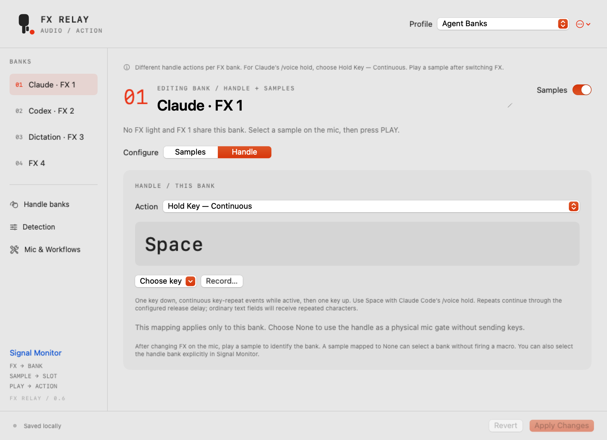

<p align="center"></p>

A small native macOS utility that turns the **Teenage Engineering EP-2350 FX-MIC** into a configurable controller for your apps.

Squeeze the handle to gate your microphone. Play a sample to send a key, shortcut or command. Choose a profile for your workflow. **Your agent or dictation app handles speech; the bridge only turns signals into actions.**

**macOS 15+ · Swift / SwiftUI · Four banks · Sixteen samples · Per-bank handle actions · Local profiles**

**Made possible by [tink-agent](https://github.com/tajchert/tink-agent), by Michal Tajchert.** Its exploration of the FX-MIC as an agent controller and its sample/pitch configuration were the starting point for this project. FX Relay builds on that inspiration with a focused native controller, diagnostic tooling and configurable workflows. [Acknowledgements and reference license →](THIRD_PARTY_NOTICES.md)

[Get started](docs/GETTING_STARTED.md) · [Profiles](docs/PROFILES.md) · [Dictation options](docs/VOICE_OPTIONS.md) · [Managed Macs / CLI](docs/MANAGED_MACS.md) · [Build](docs/DEVELOPMENT.md) · [Progress](docs/HISTORY.md)



*Actual SwiftUI view rendered offscreen with the Agent Banks starter profile. This image demonstrates the layout, not a live hardware test.*

## A mic with something extra

- **One setup, four banks.** Install the standard cue pack from the app. Pick an FX bank and sample slot on the mic; PLAY fires the configured action.
- **A handle action per bank.** Give FX 1 a key hold and FX 2 no keyboard action, or configure all four independently. A sample identifies the bank after switching FX.
- **Your controls, your mappings.** Hold Key, Hold Key — Continuous, Keystroke, Shortcut, Type Text, optional delayed Enter, or None. Record shortcuts directly in the editor.
- **Starter workflows.** Codex, Claude Code · Tap, Apple Dictation and Agent Banks are included. Duplicate, rename, edit and share profiles as JSON.
- **See what the mic is doing.** Live RMS/peak, amplitude history, spectrum, cue counters and event logs. Diagnostic exports contain measurements, not audio recordings.
- **A small macOS utility.** Custom menu-bar status mark, light/dark UI, explicit input selection and background analysis. No account or package dependencies.

## Get started

1. Build using the commands below, then move **FX Relay.app** from `dist` into **Applications**, your personal `~/Applications` folder, or another stable folder you own. Open that copy and look in the menu bar. Grant Microphone and Accessibility permissions when requested.
2. Connect the mic's analogue output to a compatible input adapter and select that adapter in the menu bar. Configure your target app's microphone separately.
3. For initial setup, connect USB-C and expose **FX MIC DISK**. Open **Edit Mappings → Mic & Workflows → Choose FX MIC DISK**. Review the inspection, then **Install Four Banks**. Existing known packs can be upgraded; custom files are left for review. The app keeps a local backup.
4. Eject the disk in Finder so the mic reloads the pack. Resume monitoring and play each sample with keyboard output off.
5. Choose a starter profile. Configure its target app, then enable output and focus a blank test document during the three-second countdown.

[Full setup and hardware check →](docs/GETTING_STARTED.md)

## Start with a profile

| Profile | Base bank samples 1–4 | Setup |
| --- | --- | --- |
| **Codex** | Return · F8 voice toggle · Escape · Control+C | Requires a Codex CLI build/session supporting voice |
| **Claude Code · Tap** | Return · Space record/send · Escape · Control+C | Enable `/voice tap`; the second Space can submit the prompt |
| **Apple Dictation** | ⌃⌥D dictation toggle · Escape · Return · Undo | Set the same shortcut in macOS Keyboard settings |

Those three leave the handle's keyboard mapping off: the handle still gates the analogue mic. Every mapping is editable, and generic Hold-Space, Command Voice, Blank and Dictation Shortcut templates are also available. Text commands in starter profiles leave automatic Enter off.

The second bank supplies commands such as `/voice` and `/compact`; the third provides navigation keys. The fourth is available for your own mappings. Apple Dictation repeats its four shortcuts across all banks. [View all defaults and compatibility notes →](docs/PROFILES.md)

**Agent Banks** puts Claude in FX 1, Codex in FX 2 and Dictation in FX 3 within one profile. New copies use continuous Hold Space in FX 1 and no handle key elsewhere. Enable `/voice hold` in Claude first. Existing saved profiles retain their mappings; choose **Hold Key — Continuous** explicitly when upgrading. Choose a bank → **Handle** to edit it. Sample 4 is unassigned in every bank so it can identify that bank without sending a macro. [Bank routing and handle checks →](docs/PROFILES.md#handle-actions-per-bank)

## How it works

```text
FX-MIC → audio adapter → local signal analysis → control event → configured action
            └────────→ your agent / dictation app receives its own mic input
```

The orange button selects an FX preset. The sample selector chooses one of four slots. PLAY emits its cue. Pitch-shifted presets give the same samples different identities across four banks. No-FX and FX 1 share a bank. The UI shows **last played**, because silent selector changes cannot be observed. Handle routing follows that last detected bank or an explicit manual selection. With different handle mappings and no known bank, handle actions wait for identification.

The bridge does not transcribe, route, mute, replace or upload your audio. Cue sounds remain in the signal heard by your other apps.

## Current status

This is a working development build, with these boundaries:

- Base and FX 2 cue frequencies have been measured on hardware. The four-bank pack is installed on the development mic; **FX 3/4 analogue playback still needs its physical check**. Generated-cue tests cover all sixteen targets.
- Voice transcription was reported to stop in FX 3/4 and resume in the base bank. The cause is unconfirmed; use the base bank for voice until the [voice-bank check](docs/VOICE_BANK_CHECK.md) separates hardware behavior from keyboard actions. Cue recognition alone does not establish voice compatibility.
- Handle keyboard output follows sound activity. A quiet pause can release a key while the handle remains squeezed; it is not a direct hardware-switch sensor.
- **Hold Key** sends one down/up pair. **Hold Key — Continuous** adds marked repeat events for terminal hold modes such as Claude's `/voice hold`. Repeats stop on signal release, focus loss, capture failure or output disable. Native single-hold receipt is verified; continuous delivery and target-app voice behavior still need a live check. The Claude Code · Tap starter remains a separate workflow.
- Output starts off and disarms on focus, profile, permission or capture changes. Independent held-key leases provide a release timeout. Force-kill/OS failure cannot run normal cleanup.
- App bundles are locally ad-hoc signed. Developer ID signing and notarization remain a distribution step; no public binary release is claimed here.

## Build it

Requires macOS 15+, an installed Swift toolchain, and full Xcode for tests.

```sh
git clone https://github.com/jh3y/fx-relay.git
cd fx-relay
./script/build_and_run.sh --build-only
```

Move `dist/FX Relay.app` into Applications or a folder you own, then open it. It runs in the menu bar and intentionally has no Dock icon. Keep one installed copy and open that same copy consistently. Running the build script without `--build-only` instead opens the development copy in `dist`. Builds use release optimization and two compiler jobs by default.

To stop actions, use **Disable Keyboard Output**. **Pause** stops audio monitoring; **Quit** closes the app and releases its held keys. To uninstall, quit and move the app to the Trash. Preferences and mic backups remain available; there is no login helper or background service to remove. Uninstalling the Mac app does not restore the mic's hardware configuration. See [removal details](docs/MANAGED_MACS.md#stopping-and-removing-the-app).

```sh
swift test --jobs 2 --configuration release
python3 -m unittest discover -s Tests/DeviceSetupTests -v
```

[Development, architecture and validation →](docs/DEVELOPMENT.md)

## Made to be yours

Profiles are local JSON configuration, independent of your agent or dictation service. Importing one never arms output or changes the microphone. No automatic app switching, shell-command execution, speech model or cloud connection is built into the bridge.

[Contributing](CONTRIBUTING.md) · [Brand assets](docs/BRANDING.md) · [Acknowledgements](THIRD_PARTY_NOTICES.md)

Released under the [MIT license](LICENSE). The project was previously called FX-MIC Bridge. This is an independent project, not affiliated with Teenage Engineering, Apple, OpenAI or Anthropic.
