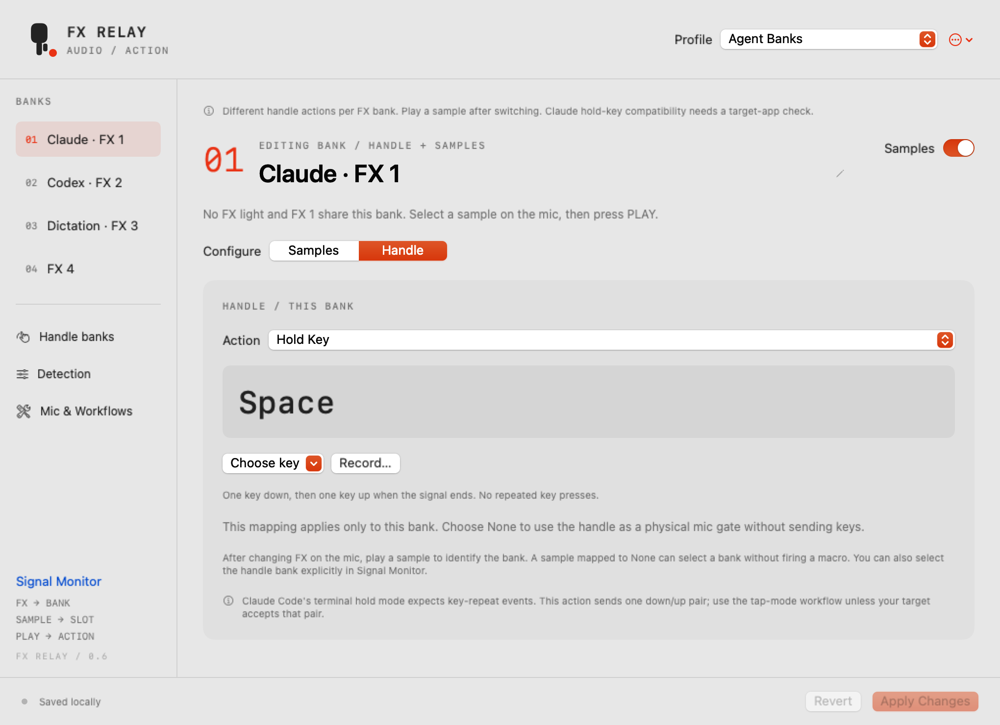
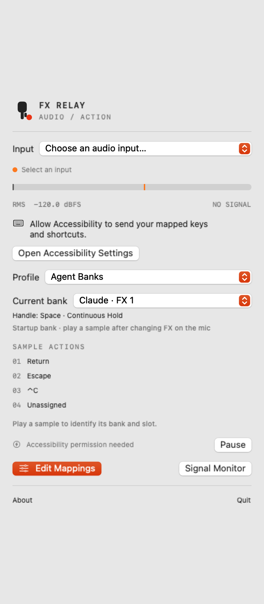
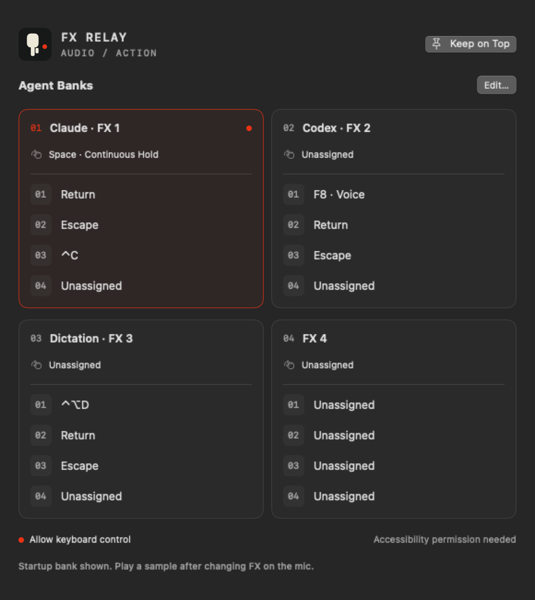
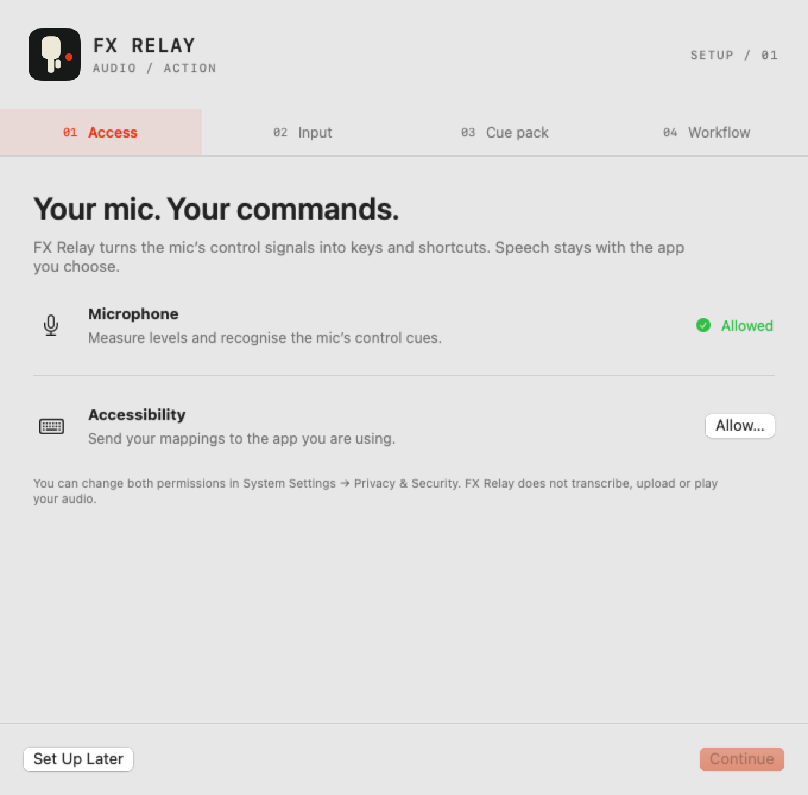
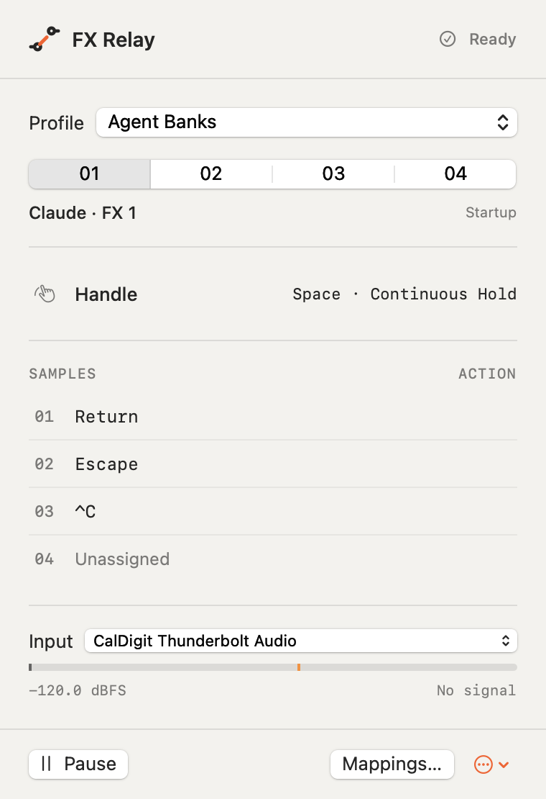
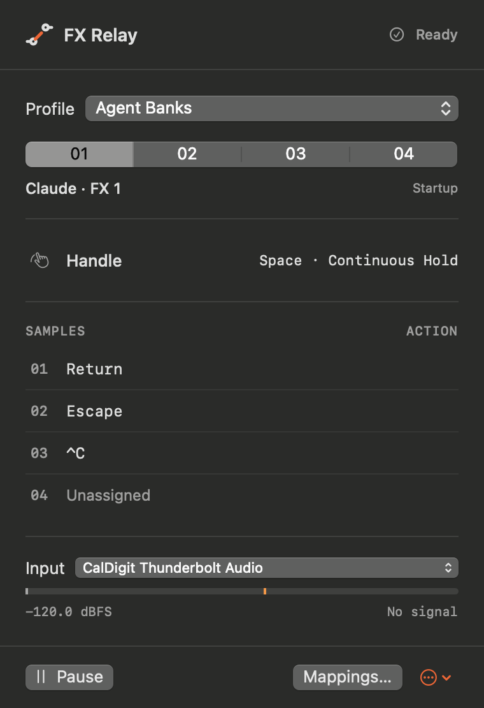
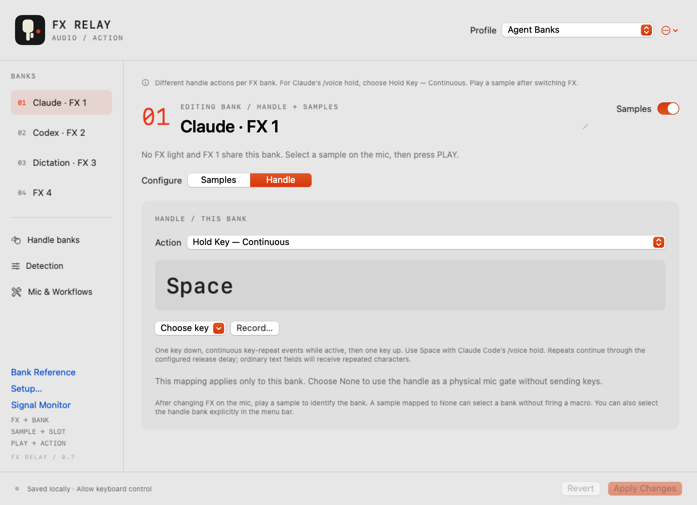
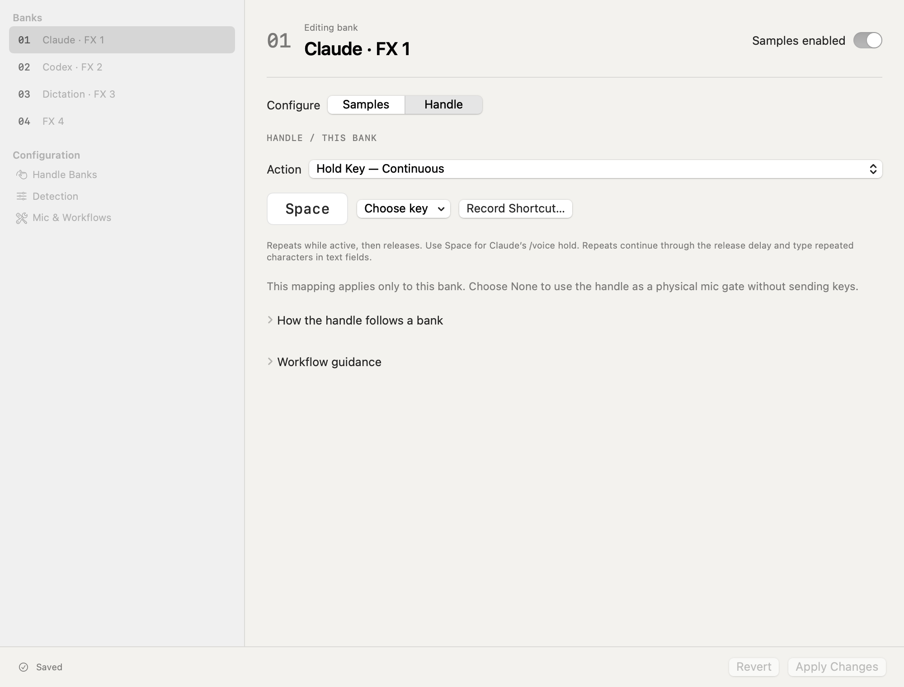

# From instrumentation to a controller

The project was developed by measuring the real hardware before assigning behavior. Earlier source/app snapshots and checksums remain preserved locally; raw diagnostic reports and personal device backups are not part of the public source export.

| Version | Milestone |
| --- | --- |
| 0.1.0 | Menu-bar instrumentation: selected input, levels, waveform, spectrum and an explicit Space test |
| 0.1.1–0.1.2 | Guided diagnostics and clearer timing instructions |
| 0.2.0 | Sound-based PTT, four cue detectors and key-release protection |
| 0.2.1–0.2.2 | Optimized builds and visibility-based redraw throttling |
| 0.2.3–0.2.4 | Detailed traces, activation confirmation and independent keyboard-receipt testing |
| 0.2.5 | Isolated orange-button experiment; no useful independent press event measured |
| 0.3.0 | Two tone banks, profiles, JSON and text actions |
| 0.4.0 | Dedicated mapping window, four-bank pack, Dictation template and first icon |
| 0.5.0 | Renamed FX Relay; starter profiles, native four-bank setup, custom menu-bar identity, UI polish and repository preparation |
| 0.6.0 | Per-bank handle actions, Agent Banks starter, independent sound detection and clearer routing/keyboard diagnostics |
| 0.6.1 | Optional continuous key holds for terminal voice modes, with marked autorepeat and safe cancellation |
| 0.6.2 | Automatic output to the focused app, one Pause control, visible startup bank and preserved bank selection during edits |
| 0.6.3 | Real terminal receipt testing finds dropped marked repeats; targeted ordinary key-down repeats deliver all Spaces |
| 0.7.0 | Guided setup, honest capture/permission readiness, four-bank reference, Launch at Login, refined branding and stable local signing |
| 0.7.1 | Standalone modifier holds and system delivery for handle actions, including Option for external dictation apps |
| 0.7.2 | Clear the bridge's own echoed modifier state on release; add native normal/timeout/next-hold verification |
| 0.8.0 | Contact identity, compact adaptive popover, native sidebar/toolbar editor and coherent light/dark utility surfaces |
| 0.8.1 | Remove duplicate focus/permission queries and reduce hidden diagnostic spectrum refresh; retain control timing and release safeguards |

v0.8.1 passed 128 optimized Swift tests. Quiet, windows-closed measurements on the same M2 Max were 3.43–3.63% of one CPU core versus a 6.33% v0.8.0 baseline (short observations, not an energy benchmark). After opening Hex, the user confirmed that the handle dictation workflow still works. It continues to follow speech activity and silence, rather than physical handle position.

## The interface, then and now

v0.4.0 introduced a separate mapping editor after the combined diagnostic/editor view became unusable. v0.5.0 gives each selected action its own panel and makes mic setup available inside the app.

 

Both images are offscreen renders of their actual SwiftUI views, not live microphone screenshots.

v0.6.0 adds a Handle tab within each bank, so one profile can use different handle actions across workflows.

v0.6.2 removes repeated arming and the countdown. The menu bar has one Current bank selector and one Pause/Resume control. Signal Monitor observes without a separate output setup.

## Findings that shaped the design

v0.7 adds a separate reference window and guided setup. The underlying detector and key-delivery behavior remain those confirmed in v0.6.3.

- Held-silent and released-handle noise floors overlapped, so physical handle position cannot be inferred reliably from silence alone. PTT follows sound activity with confirmation/hysteresis/release delay.
- Sample cues play with the handle released, allowing macros independently of speech.
- Orange selects an FX preset. Changing pitch gives sample slots more identities; the selector itself has no usable measured event. The app reports the last played bank, not a silently selected one.
- Native down/up receipt does not establish a terminal's voice behavior. Claude's repeat-based hold detection now has an explicit compatibility note and a tap-mode starter.
- v0.7.2 clears the bridge's own echoed modifier state on release. The user confirmed that an Option handle mapping then completes Hex dictation and pastes after release; the configured sound-gate delay still applies.
- Base and FX 2 are measured. FX 3/4 predictions pass generated-signal tests, and the user reports successful presses across all sixteen slots. Voice behavior in each FX mode remains a separate check.

## Public source

On November 4, 2026, FX Relay was published as [jh3y/fx-relay](https://github.com/jh3y/fx-relay) under the MIT license. [tink-agent](https://github.com/tajchert/tink-agent), by Michal Tajchert, was the starting point that made this project possible; its reference contribution and license are preserved in the acknowledgements. The first public source is v0.5.0, with the earlier milestones retained in this history and the local immutable archives.

## Contact appearance

v0.8.0 replaces the repeated brand headers and nested cards with an original relay-contact identity, a compact operating panel and a native sidebar editor. The normal popover measures 380 × 555 points. The same semantic colors and spacing extend through Setup, Detection, Bank Reference and Signal Monitor. Editing and active microphone banks remain separate; saved actions and signal detection retain their earlier behavior.

 

These are native view renders with isolated fixture data. They do not show the live hardware state or native window toolbar.

Before (v0.7.2) and after (v0.8.0), using the Agent Banks handle editor:

 
