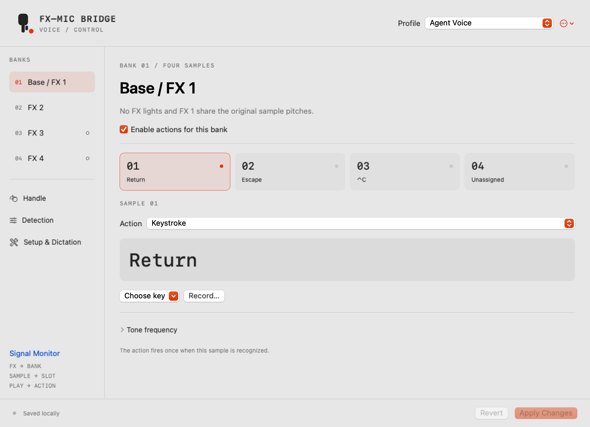
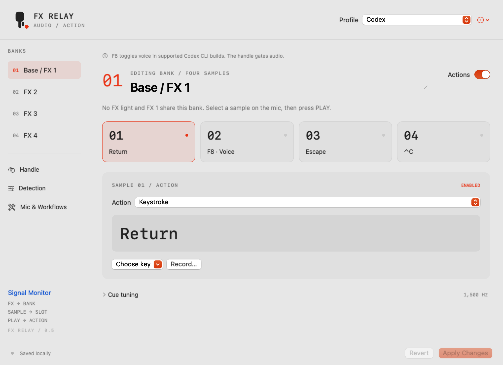

# From instrumentation to a controller

The project was developed by measuring the real hardware before assigning behavior. Earlier source/app snapshots and checksums remain preserved locally; raw diagnostic reports and personal device backups are not part of the public source export.

| Version | Milestone |
| --- | --- |
| 0.1.0 | Menu-bar instrumentation: selected input, levels, waveform, spectrum and an explicit Space test |
| 0.1.1–0.1.2 | Guided diagnostics and clearer timing instructions |
| 0.2.0 | Sound-based PTT, four cue detectors and key-release protection |
| 0.2.1–0.2.2 | Optimized builds and visibility-based redraw throttling |
| 0.2.3–0.2.4 | Detailed traces, activation confirmation and independent keyboard-receipt testing |
| 0.2.5 | Isolated orange-button experiment; no useful independent press event measured |
| 0.3.0 | Two tone banks, profiles, JSON and text actions |
| 0.4.0 | Dedicated mapping window, four-bank pack, Dictation template and first icon |
| 0.5.0 | Renamed FX Relay; starter profiles, native four-bank setup, custom menu-bar identity, UI polish and repository preparation |

## The interface, then and now

v0.4.0 introduced a separate mapping editor after the combined diagnostic/editor view became unusable. v0.5.0 gives each selected action its own panel and makes mic setup available inside the app.

 

Both images are offscreen renders of their actual SwiftUI views, not live microphone screenshots.

## Findings that shaped the design

- Held-silent and released-handle noise floors overlapped, so physical handle position cannot be inferred reliably from silence alone. PTT follows sound activity with confirmation/hysteresis/release delay.
- Sample cues play with the handle released, allowing macros independently of speech.
- Orange selects an FX preset. Changing pitch gives sample slots more identities; the selector itself has no usable measured event. The app reports the last played bank, not a silently selected one.
- Native down/up receipt does not establish a terminal's voice behavior. Claude's repeat-based hold detection now has an explicit compatibility note and a tap-mode starter.
- Base and FX 2 are measured. FX 3/4 predictions pass generated-signal tests but their analogue confirmation remains a separate physical check.

## Public source

On November 4, 2026, FX Relay was published as [jh3y/fx-relay](https://github.com/jh3y/fx-relay) under the MIT license. [tink-agent](https://github.com/tajchert/tink-agent), by Michal Tajchert, was the starting point that made this project possible; its reference contribution and license are preserved in the acknowledgements. The first public source is v0.5.0, with the earlier milestones retained in this history and the local immutable archives.
